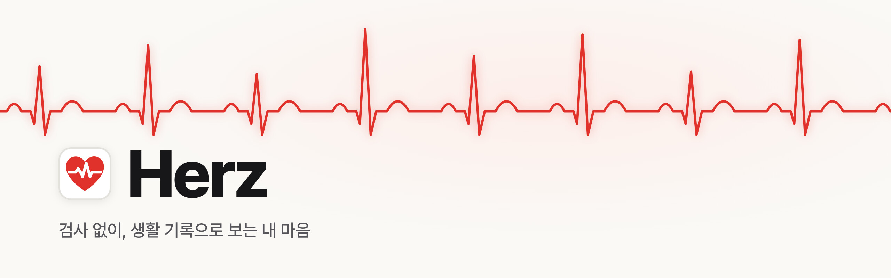
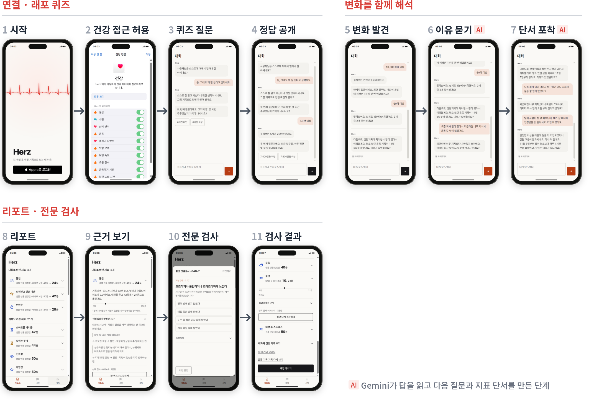
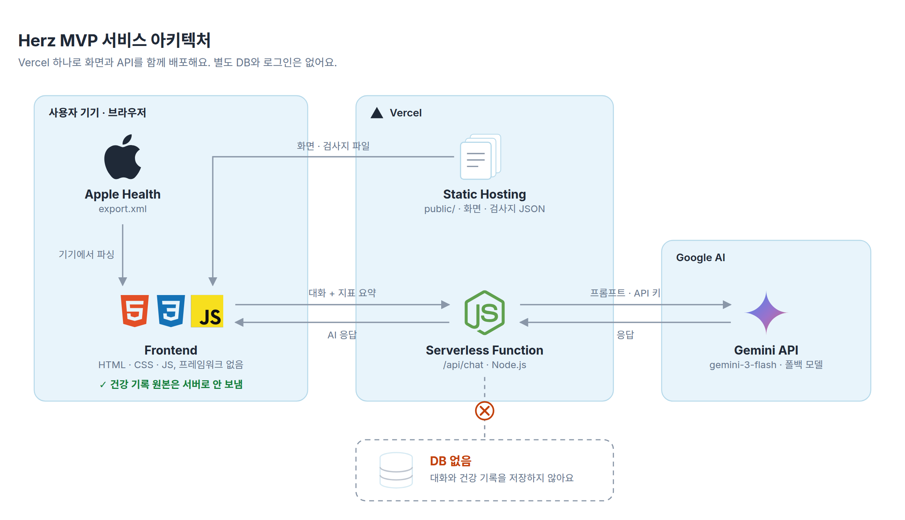

<p align="center">
  <a href="https://maeum-mirror.vercel.app/?view=phone"></a>
</p>

<p align="center">
  
  
  
  
</p>

<h1 align="center">Herz</h1>

<p align="center">AI 에이전트가 흩어진 생활 기록을 통해 변화를 파악, 심리 상태를 분석 및 추적하는 서비스</p>

<p align="center">
  <a href="https://maeum-mirror.vercel.app/?view=phone"></a>
</p>

https://github.com/user-attachments/assets/079991b4-0f4c-4ba6-8a1a-10f0afac96b9

<p align="center">
  <a href="demo-video/submitted/herz-demo.mp4">시연 영상 (1분 47초)</a> ·
  <a href="docs/submission/INTRO.md">서비스 소개서</a> ·
  <a href="docs/hackathon-2026/README.md">대한상공회의소 AI 해커톤 공고</a> ·
  <a href="research/README.md">조사 자료</a>
</p>

## 무엇을 하나요

Apple 건강 기록에서 최근 2주와 평소의 나를 비교하고, 달라진 부분을 대화로 짚어 봅니다.

<p align="center">
  
</p>

- **연결 · 래포 퀴즈 (1–4)**: `export.xml`은 브라우저 안에서만 읽고, 가벼운 퀴즈로 말문을 엽니다.
- **변화를 함께 해석 (5–7)**: 달라진 지표마다 이유를 묻고, 그 답의 이유를 한 번 더 묻습니다.
- **리포트 · 전문 검사 (8–11)**: 점수는 검증된 검사지로만 매깁니다.

건강 기록 원본은 서버로 가지 않습니다. DB와 로그인도 없습니다.

> 지표와 검사지를 고른 근거는 [근거와 연구](#근거와-연구)에 있습니다.

## 실행

Node.js 18 이상이 필요합니다. 빌드 단계는 없습니다.

```bash
cp .env.example .env   # GEMINI_API_KEY를 채웁니다. 비워 두면 정해진 대본으로 응답하는 데모 모드
npm start              # http://localhost:8787
```

```bash
npm test               # lint와 node --test test/
npm run sample         # 가상 사용자 데이터 다시 만들기
```

배포 방법과 설정 이유는 [`docs/submission/DEPLOY.md`](docs/submission/DEPLOY.md)에 있습니다. GitHub에 푸시해도 배포되지 않습니다. 배포는 Vercel CLI로 합니다.

## 구조

<p align="center">
  
</p>

화면과 API는 Vercel 하나로 배포합니다. 대화와 지표 요약만 `/api/chat`을 거쳐 Gemini API로 갑니다. 그림 원본은 [`docs/readme/architecture.html`](docs/readme/architecture.html)에 있습니다.

```text
.
├── public/                 정적 화면. Vercel이 그대로 서빙합니다
│   ├── index.html
│   ├── js/
│   │   ├── parse.js        export.xml을 브라우저 안에서 스트리밍으로 읽습니다
│   │   ├── metrics.js      평소와 최근 14일을 비교해 요약 숫자를 만듭니다
│   │   ├── change-talk.js  달라진 지표마다 이유를 두 번 묻는 2단계 대화
│   │   ├── prompt.js       AI에게 가는 고정 지시문과 응답 형식
│   │   ├── safety.js       위기 신호와 금지 표현을 고정 규칙으로 처리합니다
│   │   └── ...
│   ├── spec/metrics.js     지표별 근거 강도, 연구 숫자, 하지 않을 말
│   ├── tests/              검사지 JSON과 공개 여부 index.json
│   └── sample/             가상 사용자 샘플
├── api/                    Vercel 서버리스 함수 (chat.js, status.js)
├── lib/chat.mjs            Gemini 호출과 모델 폴백. api/와 server.mjs가 같이 씁니다
├── server.mjs              로컬 서버. 정적 파일 서빙과 /api 중계
├── spec/                   대화와 리포트 규칙, 검사 원문 정리
├── test/                   node --test 테스트
├── testbed/                가상 페르소나로 대화를 돌려 보는 실험대
├── research/               조사 보고서와 출처
├── docs/                   결정 기록, ADR, 제출 문서
└── scripts/                샘플 생성기와 lint
```

## 문서 지도

| 문서 | 내용 |
|---|---|
| [`PRODUCT.md`](PRODUCT.md) | 사용자, 목적, 제약, 해커톤 기준 |
| [`GLOSSARY.md`](GLOSSARY.md) | 이 저장소에서 쓰는 용어 정의 |
| [`docs/decisions-2026-11-22.md`](docs/decisions-2026-11-22.md) | 방향을 바꾼 결정과 이유 |
| [`docs/adr/`](docs/adr/) | 설계 결정 기록 (ADR) |
| [`spec/conversation-to-report.md`](spec/conversation-to-report.md) | 대화에서 리포트로 가는 규칙 |
| [`spec/walking-sleep.md`](spec/walking-sleep.md) | 걸음과 수면 측정 규칙 |
| [`testbed/DEMO-CHECKLIST.md`](testbed/DEMO-CHECKLIST.md) | 페르소나 실험대의 시연 점검표 |
| [`docs/submission/INTRO.md`](docs/submission/INTRO.md) | 서비스 소개서 계획 |
| [`docs/hackathon-2026/`](docs/hackathon-2026/) | 공식 공고와 첨부 PDF |
| [`docs/presentation/`](docs/presentation/) | 제출한 발표 deck과 슬라이드 이미지 |
| [`demo-video/`](demo-video/PLAYBOOK.md) | 제출한 시연 영상, 촬영 스크립트, 만드는 방법 |

## 근거와 연구

Herz가 지표를 고르고, 대화를 설계하고, 점수를 매길 때 기댄 연구입니다. 화면과 프롬프트에 쓰는 숫자는 원문에서 확인한 것만 씁니다. 항목 끝의 `S04-01` 같은 ID는 [`research/`](research/README.md)의 출처 카드 번호입니다. 카드에는 원문 인용과 확인 범위가 적혀 있습니다.

<details>
<summary><b>생활 기록과 마음</b> · 13편 · 수면, 걸음, 심박</summary>

**수면과 하루 리듬**

- <a id="r1"></a>[1] Lyall, L. M., et al. (2018). Association of disrupted circadian rhythmicity with mood disorders, subjective wellbeing, and cognitive function: A cross-sectional study of 91 105 participants from the UK Biobank. *The Lancet Psychiatry*, 5(6), 507–514. https://doi.org/10.1016/S2215-0366(18)30139-1 `S04-01`
- <a id="r5"></a>[5] Zhai, L., Zhang, H., & Zhang, D. (2015). Sleep duration and depression among adults: A meta-analysis of prospective studies. *Depression and Anxiety*, 32(9), 664–670. https://doi.org/10.1002/da.22386 `S04-07`
- <a id="r6"></a>[6] Li, D. R., et al. (2025). Regular sleep patterns, not just duration, critical for mental health: Association of accelerometer-derived sleep regularity with incident depression and anxiety. *Psychological Medicine*, 55, e239. https://doi.org/10.1017/S0033291725101281 `S04-08`
- <a id="r7"></a>[7] Fang, Y., et al. (2021). Day-to-day variability in sleep parameters and depression risk: A prospective cohort study of training physicians. *npj Digital Medicine*, 4(1), 28. https://doi.org/10.1038/s41746-021-00400-z `S04-09`

**센서 종합 예측**

- <a id="r2"></a>[2] Rykov, Y., et al. (2021). Digital biomarkers for depression screening with wearable devices: Cross-sectional study with machine learning modeling. *JMIR mHealth and uHealth*, 9(10), e24872. https://doi.org/10.2196/24872 `S04-02`
- <a id="r3"></a>[3] Moshe, I., et al. (2021). Predicting symptoms of depression and anxiety using smartphone and wearable data. *Frontiers in Psychiatry*, 12, 625247. https://doi.org/10.3389/fpsyt.2021.625247 `S04-03`
- <a id="r4"></a>[4] Saeb, S., et al. (2015). Mobile phone sensor correlates of depressive symptom severity in daily-life behavior: An exploratory study. *Journal of Medical Internet Research*, 17(7), e175. https://doi.org/10.2196/jmir.4273 `S04-04`

**걸음과 신체 활동**

- <a id="r8"></a>[8] Bizzozero-Peroni, B., et al. (2024). Daily step count and depression in adults: A systematic review and meta-analysis. *JAMA Network Open*, 7(12), e2451208. https://doi.org/10.1001/jamanetworkopen.2024.51208 `S04-11`
- <a id="r9"></a>[9] Pearce, M., et al. (2022). Association between physical activity and risk of depression: A systematic review and meta-analysis. *JAMA Psychiatry*, 79(6), 550–559. https://doi.org/10.1001/jamapsychiatry.2022.0609 `S04-12`
- <a id="r10"></a>[10] Chekroud, S. R., et al. (2018). Association between physical exercise and mental health in 1·2 million individuals in the USA between 2011 and 2015: A cross-sectional study. *The Lancet Psychiatry*, 5(9), 739–746. https://doi.org/10.1016/S2215-0366(18)30227-X `S04-13`

**심박과 HRV**

- <a id="r11"></a>[11] Galin, S., et al. (2026). Heart rate variability as a predictor of future depressive symptoms: A systematic review and meta-analysis. *Journal of Affective Disorders*, 403, 121388. https://doi.org/10.1016/j.jad.2026.121388 `S04-17`
- <a id="r12"></a>[12] Presby, D., et al. (2025). Inter- and intrapersonal associations between physiology and mental health: A longitudinal study using wearables and mental health surveys. *Journal of Medical Internet Research*, 27, e64955. https://doi.org/10.2196/64955 `S04-19`
- <a id="r13"></a>[13] O'Grady, B., et al. (2024). The validity of Apple Watch Series 9 and Ultra 2 for serial measurements of heart rate variability and resting heart rate. *Sensors*, 24(19), 6220. https://doi.org/10.3390/s24196220 `S04-36`

</details>

<details>
<summary><b>심리검사와 한국어판 검증</b> · 13편 · PHQ, GAD, TIPI, SWLS, MLQ, CBI</summary>

**우울과 불안 (PHQ, GAD)**

- <a id="r14"></a>[14] Kroenke, K., Spitzer, R. L., & Williams, J. B. W. (2001). The PHQ-9: Validity of a brief depression severity measure. *Journal of General Internal Medicine*, 16(9), 606–613. https://doi.org/10.1046/j.1525-1497.2001.016009606.x
- <a id="r15"></a>[15] Spitzer, R. L., Kroenke, K., Williams, J. B. W., & Löwe, B. (2006). A brief measure for assessing generalized anxiety disorder: The GAD-7. *Archives of Internal Medicine*, 166(10), 1092–1097. https://doi.org/10.1001/archinte.166.10.1092
- <a id="r16"></a>[16] Kroenke, K., Spitzer, R. L., Williams, J. B. W., & Löwe, B. (2009). An ultra-brief screening scale for anxiety and depression: The PHQ-4. *Psychosomatics*, 50(6), 613–621. https://doi.org/10.1176/appi.psy.50.6.613 `S06-04`
- <a id="r17"></a>[17] Kim, H. W., Shin, C., Lee, S. H., & Han, C. (2021). Standardization of the Korean version of the Patient Health Questionnaire-4 (PHQ-4). *Clinical Psychopharmacology and Neuroscience*, 19(1), 104–111. https://doi.org/10.9758/cpn.2021.19.1.104 `S06-05`
- <a id="r18"></a>[18] Kim, M., et al. (2023). Validation of the Patient Health Questionnaire-9 and Patient Health Questionnaire-2 in the general Korean population. *Psychiatry Investigation*, 20(9), 853–860. https://doi.org/10.30773/pi.2023.0100 `S06-06`
- <a id="r19"></a>[19] Shin, C., Ko, Y. H., An, H., Yoon, H. K., & Han, C. (2020). Normative data and psychometric properties of the Patient Health Questionnaire-9 in a nationally representative Korean population. *BMC Psychiatry*, 20, 194. https://doi.org/10.1186/s12888-020-02613-0 `S03-09`
- <a id="r20"></a>[20] Ahn, J. K., Kim, Y., & Choi, K. H. (2019). The psychometric properties and clinical utility of the Korean version of GAD-7 and GAD-2. *Frontiers in Psychiatry*, 10, 127. https://doi.org/10.3389/fpsyt.2019.00127 `S06-07`

**성격 (TIPI)**

- <a id="r21"></a>[21] Gosling, S. D., Rentfrow, P. J., & Swann, W. B., Jr. (2003). A very brief measure of the Big-Five personality domains. *Journal of Research in Personality*, 37(6), 504–528. https://doi.org/10.1016/S0092-6566(03)00046-1

**삶의 만족과 의미 (SWLS, Flourishing, SPANE, MLQ)**

- <a id="r22"></a>[22] Diener, E., Emmons, R. A., Larsen, R. J., & Griffin, S. (1985). The Satisfaction With Life Scale. *Journal of Personality Assessment*, 49(1), 71–75. https://doi.org/10.1207/s15327752jpa4901_13
- <a id="r23"></a>[23] Diener, E., et al. (2010). New well-being measures: Short scales to assess flourishing and positive and negative feelings. *Social Indicators Research*, 97(2), 143–156. https://doi.org/10.1007/s11205-009-9493-y
- <a id="r24"></a>[24] Steger, M. F., Frazier, P., Oishi, S., & Kaler, M. (2006). The Meaning in Life Questionnaire: Assessing the presence of and search for meaning in life. *Journal of Counseling Psychology*, 53(1), 80–93. https://doi.org/10.1037/0022-0167.53.1.80

**번아웃 (CBI)**

- <a id="r25"></a>[25] Kristensen, T. S., Borritz, M., Villadsen, E., & Christensen, K. B. (2005). The Copenhagen Burnout Inventory: A new tool for the assessment of burnout. *Work & Stress*, 19(3), 192–207. https://doi.org/10.1080/02678370500297720
- <a id="r26"></a>[26] Jeon, G. S., You, S. J., Kim, M. G., Kim, Y. M., & Cho, S. I. (2019). Psychometric properties of the Korean version of the Copenhagen Burnout Inventory in Korean homecare workers for older adults. *PLOS ONE*, 14(8), e0221323. https://doi.org/10.1371/journal.pone.0221323

</details>

<details>
<summary><b>일상 주제 카드</b> · 6편 · 미루기, 거절 민감, 분노 반추, 감사, 퇴근 후 분리, 서두름</summary>

- <a id="r27"></a>[27] Kim, H., et al. (2020). Assessing procrastination in Korean: A study of the translation and validation of the Pure Procrastination Scale and a reexamination of the Irrational Procrastination Scale in a student and community sample. *Cogent Psychology*, 7(1), 1809844. https://doi.org/10.1080/23311908.2020.1809844
- <a id="r28"></a>[28] 박명진, 양난미 (2017). 대학생 거부민감성척도 개발 및 타당화. *한국심리학회지: 상담 및 심리치료*, 29(1), 103–127. https://doi.org/10.23844/kjcp.2017.02.29.1.103
- <a id="r29"></a>[29] 이근배, 조현춘 (2008). 한국판 분노반추척도의 타당화 연구. *정서·행동장애연구*, 24(1), 1–22. https://www.kci.go.kr/kciportal/landing/article.kci?arti_id=ART001241138
- <a id="r30"></a>[30] Grant, A. M., & Gino, F. (2010). A little thanks goes a long way: Explaining why gratitude expressions motivate prosocial behavior. *Journal of Personality and Social Psychology*, 98(6), 946–955. https://doi.org/10.1037/a0017935
- <a id="r31"></a>[31] Sonnentag, S., & Bayer, U.-V. (2005). Switching off mentally: Predictors and consequences of psychological detachment from work during off-job time. *Journal of Occupational Health Psychology*, 10(4), 393–414. https://doi.org/10.1037/1076-8998.10.4.393
- <a id="r32"></a>[32] Katsimpokis, D., Hawkins, G. E., & van Maanen, L. (2020). Not all speed-accuracy trade-off manipulations have the same psychological effect. *Computational Brain & Behavior*, 3(3), 252–268. https://doi.org/10.1007/s42113-020-00074-y

</details>

### 팀 조사 보고서

| 번호 | 주제 | 문서 |
|---|---|---|
| T1 | 청년의 마음과 심리검사를 찾는 이유 | [보고서](research/01-youth-mind/test-user-needs.md) |
| T2 | AI 상담과 가상 에이전트 선행 연구 | [보고서](research/02-ai-counseling/REPORT.md) |
| T3 | 검사와 면담이 마음을 여는 방식 | [보고서](research/03-elicitation/REPORT.md) |
| T4 | 웨어러블 데이터로 기분에 대해 말할 수 있는 것과 없는 것 | [보고서](research/04-body-to-mind/REPORT.md) |
| T5 | 전문 리포트의 문법 | [보고서](research/05-report-form/REPORT.md) |
| T6 | 짧은 심리검사 비교와 한국어판 이용 조건 | [보고서](research/06-screeners/REPORT.md) |
| T7 | 우울, 불안, 회복탄력성 척도의 현장 사용 | [보고서](research/06-screening-practice/REPORT.md) |
| T8 | 걸음과 수면으로 대화를 시작하는 근거 | [보고서](research/07-walking-sleep/REPORT.md) |
| T9 | 유사 서비스 15개 비교 | [보고서](research/08-similar-services/REPORT.md) |

## 안전 장치

- 위기 신호는 AI가 아니라 고정 규칙이 처리합니다. 자해 신호가 보이면 109(자살예방상담)와 1577-0199(정신건강위기상담)를 안내합니다. [`public/js/safety.js`](public/js/safety.js)
- PHQ-9 9번 문항에 1점 이상이면 AI를 부르지 않고 위기 안내를 띄웁니다.
- AI 답에 금지 표현(칼로리, 약 용량, 진단명 등)이 있으면 고정 문구로 바꿉니다.
- AI는 지표 변화량 숫자를 직접 쓰지 않습니다. 단서 항목과 방향만 돌려주고, 크기는 코드가 정합니다.
- 이름, 나이, 성별을 받지 않습니다. 시연 데이터는 모두 가상 사용자입니다.

## 외부 자원과 출처

Herz가 쓰는 서비스, 글꼴, 검사지와 그 이용 조건입니다. 모든 항목은 2026-11-23에 확인했습니다. 검사별 판본과 이용 근거는 [`research/06-screeners/sources.md`](research/06-screeners/sources.md)에 있습니다.

<details>
<summary><b>서비스 · 글꼴 · 검사지</b> · 9건 · 이용 조건과 용도</summary>

| | 자원 | 이용 조건 | 용도 |
|---|---|---|---|
| <a id="R1"></a>R1 | [Gemini API](https://ai.google.dev/gemini-api/terms) · Google<br>`gemini-3-flash-preview` | 무료 쿼터의 입출력은 Google 제품 개선에 쓰일 수 있어서, 시연에는 가상 사용자 데이터만 씁니다 | 대화, 요약 |
| <a id="R2"></a>R2 | [Vercel](https://vercel.com/legal/terms) Hobby · Vercel Inc. | 비상업 용도 | 배포 |
| <a id="R3"></a>R3 | [Pretendard](https://github.com/orioncactus/pretendard) v1.3.9 · 길형진 | SIL Open Font License 1.1 | 글꼴 |
| <a id="R4"></a>R4 | [PHQ-9, PHQ-2, PHQ-4, GAD-7, GAD-2 한국어판](https://www.phqscreeners.com) · Spitzer, Williams, Kroenke 외 | 개발자 매뉴얼에 따라 복제, 번역, 표시, 배포에 허가 불필요. 근거 [[14]](#r14)–[[20]](#r20) | 검사 |
| <a id="R5"></a>R5 | [TIPI 한국어판](https://gosling.psy.utexas.edu/scales-weve-developed/ten-item-personality-measure-tipi/) · Gosling (번역 Shang E. Ha) | 목적 제한 없음. 근거 [[21]](#r21) | 검사 |
| <a id="R6"></a>R6 | [SWLS, Flourishing Scale, SPANE 한국어판](https://eddiener.com) · Diener | 비상업 사용만 허용, 저자 표기 필요. 근거 [[22]](#r22), [[23]](#r23) | 검사 |
| <a id="R7"></a>R7 | [MLQ 한국판](https://www.michaelfsteger.com/?page_id=13) · Steger | 교육, 치료, 학술 목적은 무료, 상업 사용은 사전 서면 허락 필요. 근거 [[24]](#r24) | 검사 |
| <a id="R8"></a>R8 | Copenhagen Burnout Inventory 개인 소진 척도와 CBI-K · NFA | 출처를 밝히면 상업과 비상업 모두 무료. CBI-K 논문은 CC BY 4.0. 근거 [[25]](#r25), [[26]](#r26) | 검사 |
| <a id="R9"></a>R9 | 가상 사용자 건강 기록과 지표 아이콘 · Herz 팀 | 실제 개인정보 없음. 생성기 [`scripts/make-sample.mjs`](scripts/make-sample.mjs) | 시연 |

</details>
